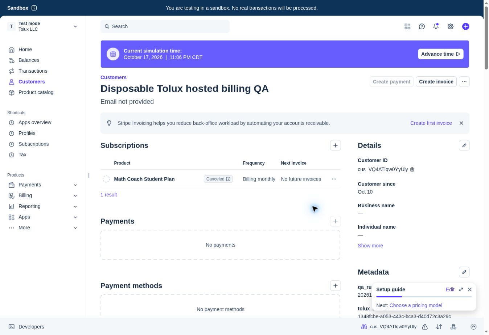

# Hosted isolated billing verification — October 11, 2026

This report records the earlier isolated test run. The subsequently authorized
production migration and live Portal setup are complete; see
[production prerequisite evidence](production-billing-prerequisites-20261011.md).
Production application deployment remains a separate release step.

## Outcome

The deployed application resolved the synthetic account's verified Stripe ownership,
created its Customer Portal session, accepted cancellation in Stripe's hosted UI,
processed real signed lifecycle callbacks, and retained the account's saved Quick
Check result after cancellation and a fresh sign-in. This is a test-mode trial
fixture, not proof of a live paid Checkout transaction or recovery of an old
production quiz that was never saved.

## Isolation and evidence

- Dedicated branch: `qa/billing-integration`; never merge/promote its staging guard.
- Executed deployment: `dpl_5jVovn5caEbivqMaKhYtHJBDF2Yt`, QA commit `8f63b4b`.
- Disposable data-less Supabase branch had zero Auth users before creation; manual
  schema-only bootstrap produced all 14 app tables with RLS. Native migration
  replay still fails on historical `rls_auto_enable()` and was not changed.
- Existing Tolux LLC Stripe test-mode account, existing price and test-only portal
  configuration. No payment method, real email, live subscription or charge.
- Existing Vercel automation access credential reused; deployment protection stayed
  enabled. Initial share-link/incorrect-credential deliveries failed (307/401);
  corrected authorized callback delivered successfully (200) and persisted usage
  and billing ownership. No callback credentials or portal URLs are in this repo.

| Executed check | Result |
| --- | --- |
| Hosted public auth configuration | Isolated staging project, not production |
| Anonymous progress request | 401 |
| Real `customer.subscription.updated` callback | Subscriber true and durable ownership row |
| Synthetic ten-item Quick Check report | 80% saved through hosted authenticated API |
| Same completion ID replay | Exactly one completion row |
| Sign out and fresh password sign-in | Hosted history contains 80% result |
| App-owned Customer Portal request | 200, verified Stripe-hosted session |
| Hosted portal Cancel subscription action | Scheduled cancellation accepted |
| Stripe clock advanced to period end | Stripe status canceled, no future invoices |
| Real cancellation callback | Subscriber false; question counter remains 4 |
| Post-cancellation fresh sign-in | 80% score retained; Full Simulation access 403 |
| Post-cancellation result replay | Exactly one completion row, score 80 |
| Second synthetic account | Empty progress history; portal request 404 |

The progress report was sent by the QA harness; this run did not click through
the ten-question assessment UI. Owner-reported preview score visibility and
cross-device confirmation from October 10 remain separately recorded evidence.

## Defect found and fixed

Actual Stripe sessions now use `https://billing.stripe.com/p/session?secret=…`.
Both existing URL validators required `/p/session/…`, causing hosted portal 502
despite successful Stripe session creation. Server and browser now also accept
the exact `/p/session` path with a nonempty `secret` parameter. Exact HTTPS Stripe
origin remains required; credentials in the authority, spoofed origins, empty
secrets and neighboring paths are rejected.

- Focused portal tests: 15/15 passed.
- Runtime PR #129 suite: 490/490 passed; QA branch: 497/497 passed.
- Syntax checks and suite's mathematical validators passed.

## Cleanup and release limits

- Disposable Supabase branch deleted; listing afterward contains only main.
- Disposable webhook disabled and its callback credential removed.
- Branch-only server/Stripe/webhook secrets and staging reference cleared; empty
  overrides retained to prevent inheriting production credentials. Inactive QA
  deployment `dpl_FPxzxpim5AmCnZqpviuEyA31LhC9` is READY and fails closed at startup.
- Synthetic Stripe subscription is canceled with no future invoices. Historical
  test customer/clock/events are retained as test-mode evidence; no live billing.
- Staging compute ran approximately 24m41s at displayed $0.01344/hour: about
  $0.00553, before other usage/tax and not a final invoice; within the $1 cap.
- Ephemeral local credential/session files removed after verification.
- Production main remains `ed1d9e49affa0a8d65cc45a3c30d25c9ec0a459f`; read-only
  production check confirms the new billing table is still absent. No production
  deployment, migration, secret/price/auth change or student data mutation.

Before release: review the additive billing migration and final application diff;
confirm/configure Customer Portal in the intended live Stripe account under owner
approval; apply the migration before deploying the application under explicit
release authorization. This run does not cover live paid Checkout, failed-payment
recovery, real-provider webhook retries after database outages, physical-phone
QA, refunds, tax/registration readiness, or every curriculum remediation cycle.

