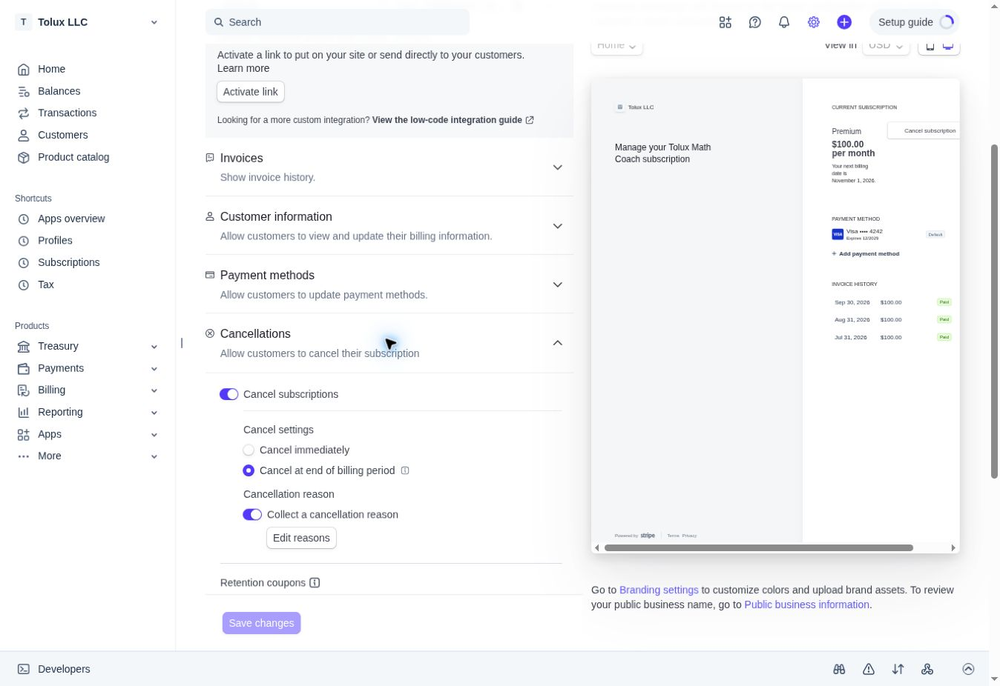

# Production billing prerequisites — October 11, 2026

The owner authorized applying the additive billing ownership migration and saving
the intended live Stripe Customer Portal configuration. Both actions completed.
PR #129 remains draft. This was not an application merge or production deployment.

## Additive database migration

- Production Supabase project: `xnadszfvjkyxltskywin`.
- Applied the reviewed SQL in
  `supabase/migrations/202610070001_create_stripe_billing_ownership.sql` using
  Supabase's migration API. Remote history records version `20261011042926`,
  name `create_stripe_billing_ownership`; the API generates its history timestamp.
  Do not treat that timestamp difference as a missing production migration or
  rerun it through an unattended migration workflow.
- `stripe_billing_ownership` exists, contains zero rows, and has RLS enabled.
- Only `service_role` has SELECT, INSERT and UPDATE. PUBLIC, anon and authenticated
  have no table privileges. Existing student tables and Auth were not modified.

| Preserved production data | Before | After |
| --- | ---: | ---: |
| Auth users | 5 | 5 |
| Lesson completion records | 30 | 30 |
| Usage records | 4 | 4 |

Sorted full-row fingerprints for completion and usage records match before/after,
verifying their contents remained intact. No scores, accounts, counters or
entitlements were reset. The new ownership table does not fabricate mappings for
existing customers; the reviewed server can recover only verified Stripe metadata.

The security advisor reports INFO `rls_enabled_no_policy` for this deliberately
server-only table. Client grants are revoked and no client policy is intended.
The existing leaked-password-protection warning was also returned; no Auth policy
was changed. [Advisor explanation](https://supabase.com/docs/guides/database/database-linter?lint=0008_rls_enabled_no_policy).

## Live Stripe Portal

- Intended account: Tolux LLC, `acct_1U76gJD6liJLynVg`.
- Saved default configuration: `bpc_1UPEReD6liJLynVgyDhtQmBD`.
- Stripe API verification: `livemode=true`, `active=true`, `is_default=true`.
- Cancellation enabled **at the end of the billing period**; no proration.
- Cancellation reasons enabled: too expensive, switched service, unused, other.
- Invoice history and payment method updates enabled.
- Plan/quantity changes, subscription pause, customer profile editing, and no-code
  login disabled. No retention coupon selected and no preview feature enabled.
- Header: “Manage your Tolux Math Coach subscription”. The default redirect remains
  unset because the application supplies its verified `/support.html#billing`
  return URL per session. Public business policy URLs remain unset; publishing
  those links was outside this prerequisite change.
- No live customer, subscription, price, payment method, charge or refund changed.

The right-hand panel is Stripe's **sample preview**. Its example $100 price and
sample customer are not Tolux's live product price or a customer transaction.

## Release status

The two previously missing prerequisites are now satisfied. Runtime code remains
at reviewed PR #129 head `7c2f68accaa6e854cabc6be2d031a1c520720a0b`;
production application main remains `ed1d9e49affa0a8d65cc45a3c30d25c9ec0a459f`.
Earlier isolated hosted QA and the 490/490 runtime suite are recorded in
`hosted-billing-20261011.md`. This follow-up changes only evidence files.

Next: review/release PR #129, then verify production sign-in, restored Test Prep
history, Help & Support, and owned Portal navigation without charging or canceling
a live subscription. Live paid Checkout, real-provider database-outage retry,
refunds, tax readiness, physical-phone behavior, and every remediation cycle remain
separate unverified areas. Never merge/promote the disposable QA guard branch.